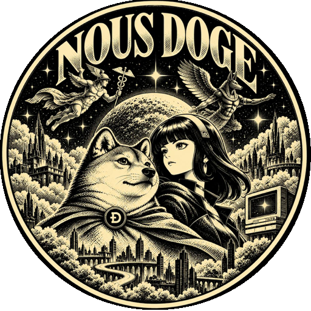

  

<h1 align="center">Nous Doge</h1>

<strong>Human Approval · Spooky Sign</strong>

A community-built Dogecoin and Doginals companion for **Hermes Agent**.

**Your keys. Your coins. Your Doginals.** Signing and broadcast happen in [Spooky Doge](https://spooksociety.github.io/SpookyDoge/), a separate, non-custodial wallet from the Spook Society. Your private keys stay in Spooky Doge Wallet on your device. Nous Doge never receives them; it passes your approved send request to Spooky for wallet confirmation, signing and broadcast.

## The boundary

- **Non-custodial:** keys stay in Spooky Doge Wallet on your device, never with the agent or this plugin.
- The agent can request a send; it cannot approve itself.
- Phone approvals are exact, expiring and single-use.
- Funding-wallet setup is separate from sending DOGE.
- Kill approvals revokes the phone; recovery requires an explicit reset and new pairing.
- A returned transaction ID is **submitted**, not a promise of confirmation or settlement.

## Status

Still in development. Code and installation instructions coming soon.

Independent community project for the Hermes community; not an official Nous Research release.
